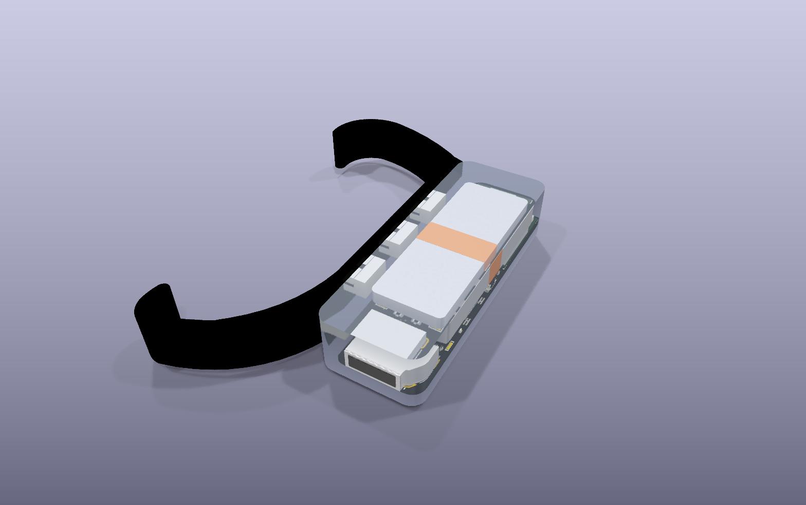
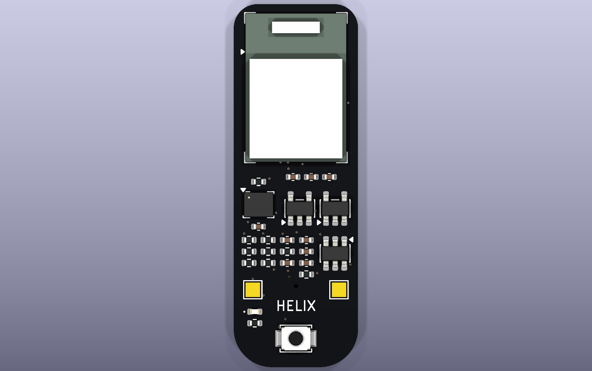
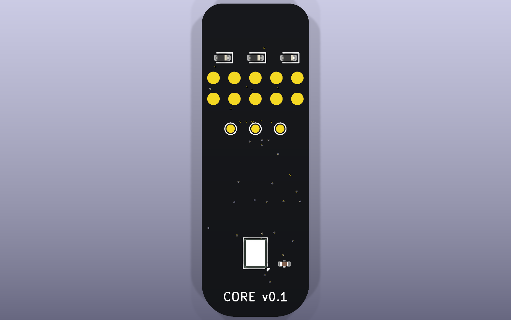
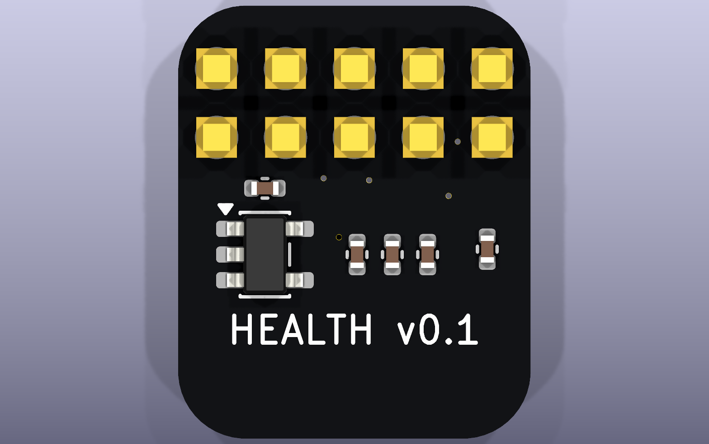
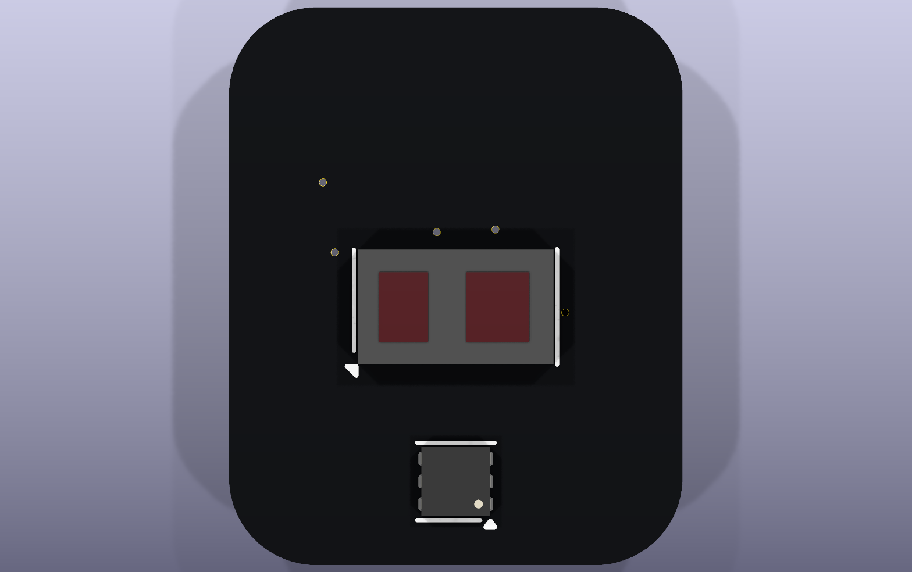

# Helix hardware

Helix as a product: a small computer worn behind the ear, and modules that snap onto it.
The boards here are designed as code with [Via](https://github.com/ThyFriendlyFox/via): each board is
a `design.py`, and the KiCad files, the gerbers and the pictures are generated from it.


## Current version: v0.2

Helix is 2 pieces: a plain printed **hook**, and one **pod** that holds everything and snaps onto
the hook's spine with 3 magnets (6 x 2 mm, 10.4 mm apart). Hooks come in sizes; the pod stays the
same. A different kind of Helix is a different pod on the same hook.

[`v0.2/core`](v0.2/core/design.py) is the pod's board, 13 x 46 mm. Against v0.1 it adds a USB-C socket
to charge and flash, a side-push button on the pod's rear edge, and 2 pads for a wireless charging
receiver; v0.1's module port and its Health board are dropped, and no health sensor is fitted (hair
lies between the pod and the skin). The cell is an LP401230 with its protection circuit, 100 mAh,
over the whole top face. The board is held to PCBWay's published limits. Its gates: ERC, DRC, SIM
and EXPORT pass, GREEN with 2 warnings (the socket's outline drawing runs over the board's edge).
Nobody has built it. [`v0.2/order`](v0.2/order/make_order.py) writes the 3 files PCBWay's order
form takes; its part numbers have not been checked against stock.



Everything below this section describes v0.1 and is kept as its record.

## The product (v0.1)

| Piece | What it is | Electronics |
|---|---|---|
| **Clip** | The hook over the ear. Printed or moulded, in sizes. Magnets hold the Core to it. | None |
| **Core** | The body behind the ear: radio, motion, microphone, cell, charger, one button, one light. Useful on its own. | [`v0.1/core`](v0.1/core/design.py) |
| **Module** | A small board that snaps onto the Core's Helix Port and adds a sense or an output. | [`v0.1/health`](v0.1/health/design.py) is the first |
| **Dock** | Where the Core sits to charge. It meets the same port, so it can also flash firmware over USB. | Not designed yet |

The first prototypes were a Seeed XIAO nRF52840 Sense and a 250 mAh cell in a printed box of
27 x 40 x 13 mm (`3D models/`). The Core's board is 13 x 38 mm. With a cell of about 100 mAh on top and
1 mm of shell, the body comes to about 15 x 40 x 9 mm: half the width and a third of the volume.

## The Helix Port

10 contacts on a 2 x 5 grid, 2.54 mm apart. The Core carries flat gold pads on its back face; a
module or the dock carries spring pins. 2 magnets in each shell, poles opposed, hold the pair and
let it seat only one way round. Seen from above the Core's top face:

| 1 VCHG | 3 GND | 5 USB D+ | 7 USB D- | 9 INT |
|---|---|---|---|---|
| **2 3V0** | **4 GND** | **6 SDA** | **8 SCL** | **10 VMOD** |

| Contact | Direction | What |
|---|---|---|
| VCHG | in | 5 V from a dock. Charges the cell and wakes USB. |
| 3V0 | out | The Core's 3.0 V rail: a module's logic reference. |
| VMOD | out | The cell, 3.0 to 4.2 V, through a load switch. Off until the firmware turns it on; soft start, so snapping a module on does not dip the cell. |
| SDA, SCL | both | I2C at 400 kHz, pulled up to 3V0 on the Core. A module adds 25 pF at most. |
| INT | in | Open drain, active low, pulled up on the Core. A module asks for attention. |
| USB D+, D- | both | The nRF52840's own USB, for the dock. |

A module is found by its I2C addresses. v0.2 should add a small ID EEPROM to every module so the
Core can name what is attached without guessing.

## Core v0.1

| | |
|---|---|
|  |  |

13 x 38 mm, 4 layers, 0.8 mm, matte black, parts on both faces.

| Block | Part | Why |
|---|---|---|
| Radio and processor | Raytac MDBT50Q-1MV2 (nRF52840, chip antenna) | The chip the XIAO carries, so the Zephyr and Arduino firmware carries over. A certified module: no antenna to design. |
| Motion | ST LSM6DS3TR-C at 0x6A | The XIAO Sense's IMU, on the same address. |
| Microphone | Knowles SPH0641LU4H-1, PDM | On the back face; its sound port is a hole through the board. |
| Charger | Microchip MCP73831, 50 mA | Half-hour rate for a 100 mAh cell. STAT goes to the processor. |
| Rail | TI TLV75530, 3.0 V | Holds regulation until the cell is nearly empty. |
| Module power | TI TPS22917 load switch | VMOD on request, slew-limited, discharged when off. |
| Protection | 3 x TI TPD1E05U06 | A TVS diode on each line the dock drives. |
| Cell voltage | 1M / 1M divider into AIN2 | 2 uA. |
| Wearer | Omron B3U button, a white light | One of each. |
| Debug | 3 pads: SWDIO, SWDCLK, nRESET | With 3V0 and GND from the port. |

Firmware pin map (nRF52840):

| Signal | Pin | Signal | Pin |
|---|---|---|---|
| SDA | P0.26 | SCL | P0.27 |
| PDM clock | P0.06 | PDM data | P0.08 |
| IMU INT1 | P0.05 | Module INT | P0.07 |
| Cell voltage / 2 | P0.04 (AIN2) | Module power enable | P1.08 |
| Charger STAT | P1.09 | Button | P0.11 |
| Light (low is on) | P0.12 | nRESET | P0.18 |

## Health v0.1

| | |
|---|---|
|  |  |

13 x 16 mm, 4 layers, 0.8 mm. Spring pins and a 1.8 V regulator on the face that meets the Core; on
the face against the skin, a MAX30102 (pulse and blood oxygen, 0x57) and a TMP117 (skin
temperature, 0x48). It runs only from VMOD, so it draws nothing until the firmware turns it on.

## Where each board stands

| Board | ERC | DRC | SIM | EXPORT | Verdict |
|---|---|---|---|---|---|
| Core | pass | pass | pass: the I2C rise time, 60 corner runs | pass | GREEN with `--strict` |
| Health | pass | pass | no deck | pass | GREEN with `--strict` |

GREEN means the open tools found no fault in the files. It does not mean a built board works.
Nobody has built either board. Before an order:

- **Parts' ratings are not judged.** Neither board has a `ratings.json`: no pin's voltage, no
  capacitor's derating and no regulator's dissipation has been held to its datasheet by a gate.
- **The antenna is not simulated.** The strip under it is bare on all 4 layers as Raytac asks, but
  the cell lies 0.5 mm from its end and a head is beside it. Range has to be measured.
- **The MAX30102's LED supply** is VMOD, and its datasheet asks 3.1 V at the least: the last part
  of the cell's discharge reads no pulse.
- **The microphone's acoustics** (the hole, the shell's port, a mesh against sweat) are not designed.
- **No cell protection on the board.** The cell must carry its own protection circuit.
- **The I2C bus capacitance** in the deck, 50 pF, is an estimate.
- **The spring pin** is named (Mill-Max 0906 series) and its land is drawn, but its outline has not
  been checked against the drawing, and the stack with the Health module on is about 14 mm thick
  at the port. A lower contact would thin it.
- **Skin contact, sweat and charging while worn** are product-safety questions no gate here asks.

## What comes next

1. The shell and the clip for these boards, sized from the assembly: where the magnets, the button
   cap, the light pipe and the microphone's port go.
2. `ratings.json` for both boards, and the charger and regulator as Via's blocks.
3. The dock: 5 V in on USB-C, 10 spring pins, USB through to the Core.
4. Firmware: one image for the Core with the IMU and microphone services, the new pin map, and
   module detection.
5. v0.2 of the Core: a 32.768 kHz crystal for lower idle current, a module ID EEPROM convention,
   and whatever the first built boards teach.

## Working on the boards

Via runs from its Docker image; nothing else is installed. From `hardware/v0.1`, in Git Bash:

```sh
via() { MSYS_NO_PATHCONV=1 docker run --rm -e KICAD10_3DMODEL_DIR=/bodies \
  -v "$PWD/../.3dmodels:/bodies" -v "$PWD:/work" ghcr.io/thyfriendlyfox/via:main "$@"; }

via python3 footprints/make_footprints.py       # the Helix Port's 2 footprints
via python3 models/make_models.py               # bodies for the parts KiCad draws without one
via workcenter design core/design.py --route    # the Core's KiCad project, routed (about 8 minutes)
via workcenter gates core --strict              # ERC, DRC, simulation, export; GREEN means done
via workcenter pictures .                       # every render into docs/
```

`.3dmodels/` holds the part bodies of KiCad's 3D library that the renders need; it is not in the
repository. The `.kicad_*` files open in KiCad 10 to look at; change `design.py`, never them.
Fabrication files are in `<board>/build/fab/` after the gates.
